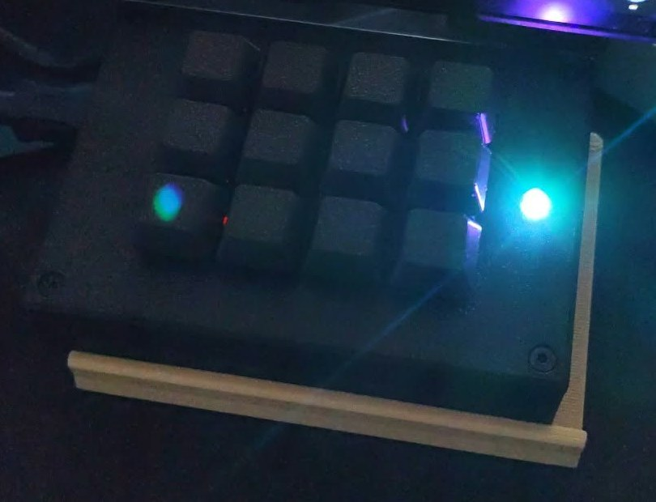
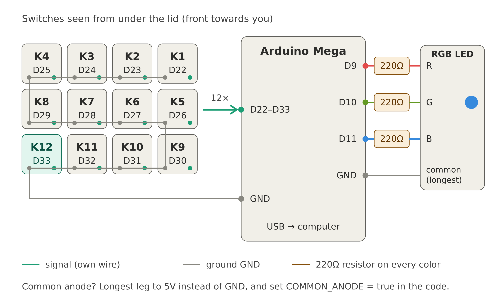
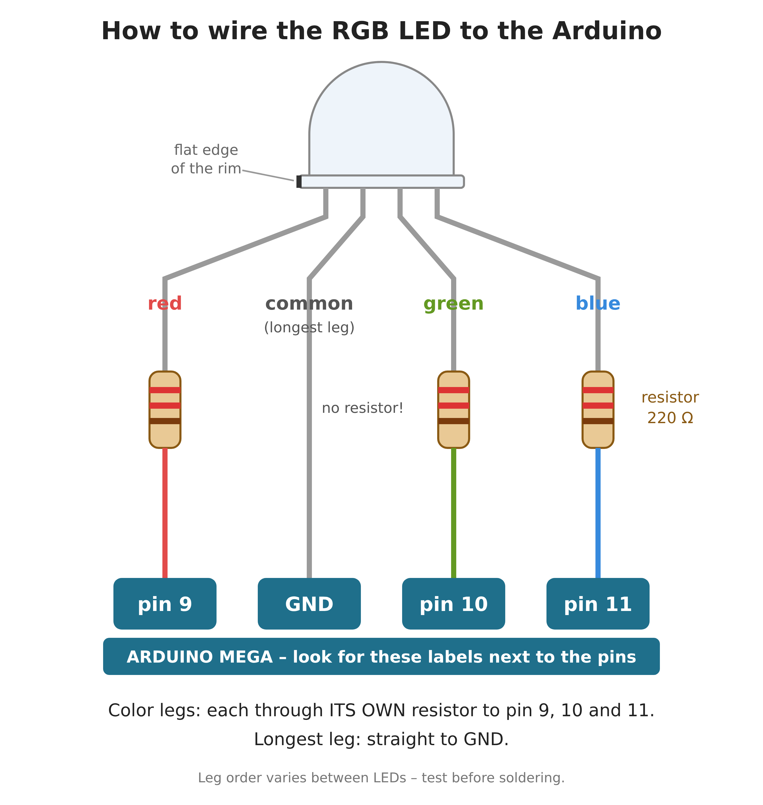

# DIY Stream Deck (Arduino Mega + RGB LED)

A 12-key desk macro pad built from an **Arduino Mega 2560**, **MX switches**, a **plain 4-pin RGB LED** and a **3D-printed case**.
A small Python program on Windows turns key presses into shortcuts, app launches, media keys and more, with switchable **profiles**.



- **K1–K11** run actions, **K12** switches profile
- the **RGB LED shows the active profile color**, flashes white on every press and pulses white when the PC program is not running
- **system tray icon** with the profile letter (blue = connected, gray = no Arduino), plus a notification on profile change
- everything is configured in one `config.json`: hotkeys, single keys, typed text, open files/URLs/`steam://` links, shell commands, multi-step sequences
- no extra Arduino libraries, no diodes in the key wiring (one pin per key)

## Repository layout

```
firmware/
  streamdeck/streamdeck.ino        main Arduino firmware
  tests/test_rgb_led/              LED wiring test
  tests/test_switches/             switch wiring test
host/
  streamdeck.py                    Windows host program (tray app)
  config.json                      profiles and key actions
  install.bat / test.bat / run.bat / autostart_enable.bat / autostart_disable.bat
hardware/
  stl/                             print-ready STL files (case, keycaps, flip legs)
  fusion/StreamDeckLow/            Fusion script that generates the case (Mega + Pro Micro variants)
  openscad/flip_legs.scad          parametric source of the flip legs
docs/images/                       wiring diagrams, photo
```

## Bill of materials

| Qty | Part |
|---|---|
| 1 | Arduino Mega 2560 (a CH340 clone works) + USB A–B cable |
| 12 | MX-style switches + keycaps (bought or printed) |
| 1 | 5 mm RGB LED, 4 legs, common cathode (common anode also works, see below) |
| 3 | 220 Ω resistors |
| – | 26 AWG wire, bare wire for the ground bus, heat-shrink, pin headers |
| 4 + 6 | M3×10 screws (lid), M3×6 screws (Arduino) |
| 2 | M3×25 screws + nylon lock nuts (flip legs) |
| – | Glue for the legs (CA or 2-part epoxy), 2 rubber feet for the front |

## Wiring



| Key | Pin | | Key | Pin | | Key | Pin |
|---|---|---|---|---|---|---|---|
| K1 | D22 | | K5 | D26 | | K9  | D30 |
| K2 | D23 | | K6 | D27 | | K10 | D31 |
| K3 | D24 | | K7 | D28 | | K11 | D32 |
| K4 | D25 | | K8 | D29 | | K12 | D33 |

- One leg of **every** switch goes to a shared **GND** wire, the other leg gets its own wire to its pin. Pins use the internal pull-ups.
- **Seen from below the lid, left and right are mirrored**: the K1 corner is on the right (see the diagram).
- RGB LED: **R → 220 Ω → D9**, **G → 220 Ω → D10**, **B → 220 Ω → D11**, **longest leg → GND**.
  For a common-anode LED, put the longest leg on **5V** and set `COMMON_ANODE = true` in the firmware.



## 1. Print the parts

| Part | File | Orientation |
|---|---|---|
| Case body | `hardware/stl/case_body.stl` | as exported (bottom down) |
| Case lid (with LED hole) | `hardware/stl/case_lid.stl` | as exported (top down) |
| Keycaps (optional) | `keycap.stl` (test fit) or `keycaps_x12.stl` (full plate) | as exported |
| Flip legs | `leg_holder.stl`, `leg_block.stl` – **print 2 of each** | as exported |

All files are already oriented for printing. Suggested settings: 0.2 mm layers, 3–4 walls, 15–25% infill, **no supports**.
Keycaps: 0.12 mm layers; print a single keycap first to check the fit on a switch.

The case is 120 × 85 mm with a sloped top (28 mm front, 34 mm back including the 5 mm lid).

### Flip legs

Two 2-position legs glued into the rear rubber-foot recesses (Ø 10.6 mm) under the case.
The holder has a small boss that centers it in the recess; the block pivots on an M3×25 screw with a nylon lock nut.

| Position | Typing angle |
|---|---|
| short end down | ~17° |
| long end down | ~26° |

Tighten the lock nut just enough that the block stays in place but can still be flipped by hand.
To tweak the legs, edit `hardware/openscad/flip_legs.scad` and render a part with
`openscad -D 'part="holder"' -o leg_holder.stl hardware/openscad/flip_legs.scad` (or `part="block"`).

### Regenerating the case in Fusion

`Shift+S` → *Scripts and Add-Ins* → `+` next to *My Scripts* → select `hardware/fusion/StreamDeckLow` → *Run*.
It builds the low Mega case, a thinner Pro Micro variant (17/21 mm) and a 15° wedge stand, and writes STLs to `Desktop/streamdeck_stl`.

## 2. Test the LED and the switches

1. Install the **Arduino IDE**, select *Tools → Board → Arduino Mega or Mega 2560* and the right port.
2. Upload `firmware/tests/test_rgb_led` and open the Serial Monitor at **115200**. It prints which color should be lit.
   - wrong color order → swap the wires on pins 9/10/11
   - inverted or nothing → common-anode LED (see Wiring)
3. Solder the switches, upload `firmware/tests/test_switches` and press every key. Each key prints its number and lights the LED in its own color. Goal: `ALL KEYS WORK!`
   - `WARNING: pressed at once` → two signal wires touch
   - `reads 'pressed' without being touched` → a signal wire touches ground

## 3. Flash the firmware

Upload `firmware/streamdeck/streamdeck.ino` (copy over any `COMMON_ANODE` / pin changes).
On power-up the LED blinks red → green → blue, then **pulses white** until the PC program connects.
**Close the Serial Monitor**, otherwise the PC program cannot open the port.

## 4. Install the PC program (Windows)

1. Install **Python 3.10+** from python.org and tick **"Add python.exe to PATH"**.
2. Copy the `host` folder somewhere permanent (e.g. `Documents\StreamDeck`).
3. Run:

| Script | What it does |
|---|---|
| `install.bat` | installs the Python libraries (once) |
| `test.bat` | test mode: shows what each key would do, **runs nothing** |
| `run.bat` | starts the program in the background |
| `autostart_enable.bat` | starts it automatically after login (`autostart_disable.bat` undoes it) |

When it runs, the LED switches to the profile color and a tray icon with the profile letter appears next to the clock
(it may be hidden under the `^` arrow; drag it onto the taskbar). Right-click the icon to pick a profile, edit or reload the config, open the log or quit.

## 5. Configure actions (`host/config.json`)

Each profile has a `name` (first letter = tray icon letter), a `color` for the LED and a list of `keys` (K1, K2, …).
After editing, right-click the tray icon → **Reload config**.

```json
{"label": "Import", "hint": "Ctrl+I", "action": {"type": "hotkey", "keys": ["ctrl", "i"], "focus": "Bambu Studio"}}
```

| Type | Fields | Example |
|---|---|---|
| `hotkey` | `keys` | `{"type":"hotkey","keys":["ctrl","shift","m"]}` |
| `key` | `key` | `{"type":"key","key":"playpause"}` (`volumeup`, `nexttrack`, `f5`, …) |
| `type` | `text` | `{"type":"type","text":"gg wp"}` |
| `open` | `target` | app path, folder, URL, `steam://rungameid/730`, `spotify:`, `discord://` |
| `launch` | `cmd` | `{"type":"launch","cmd":"calc"}` |
| `shell` | `cmd`, `cwd` | opens a console and runs the command |
| `wait` | `seconds` | used inside sequences |
| `sequence` | `steps`, `delay` | list of the actions above |

- `"focus": "Window title"` activates a window containing that text before the action.
- Environment variables work in paths (`%USERPROFILE%\\Downloads`); use double backslashes in JSON.
- Steam game ID = the number in the game's store URL.
- Other top-level options: `serial_port` (`"auto"` or e.g. `"COM5"`), `baud`, `profile_key`, `notify_on_profile_change`.

### Default profiles

| Key | Printing (blue) | Games (red) | Code (green) | Media (purple) |
|---|---|---|---|---|
| K1 | Bambu Studio | Steam | VS Code | Previous |
| K2 | Import (Ctrl+I) | Discord | Terminal | Play/pause |
| K3 | Arrange (A) | Mute mic | Git pull | Next |
| K4 | Lay flat (F) | Deafen | Git status | Volume up |
| K5 | Cut (C) | Path of Exile 2 | Run (F5) | Volume down |
| K6 | Slice (Ctrl+R) | Wallpaper Engine | Breakpoint (F9) | Mute |
| K7 | Duplicate | Game 3 (set your ID) | Save | Spotify |
| K8 | Save | Record clip | Search | YouTube |
| K9 | Undo | Game screenshot | Undo | Screenshot |
| K10 | MakerWorld | Game Bar | Copy | Calculator |
| K11 | STL folder | Volume up | Paste | Lock PC |
| K12 | *next profile* | *next profile* | *next profile* | *next profile* |

The Bambu Studio shortcuts are worth double-checking in *Help → Keyboard Shortcuts* for your version.

## Serial protocol

115200 baud, newline-terminated ASCII lines.

| Direction | Message | Meaning |
|---|---|---|
| Arduino → PC | `KEY:n` | key n (1–12) pressed |
| PC → Arduino | `C:r,g,b` | LED color of the active profile |
| PC → Arduino | `P:name` | profile name (for display variants) |
| PC → Arduino | `A:label` | last action label (for display variants) |

The PC re-sends the profile every 5 s as a heartbeat. With no message for 12 s the Arduino falls back to the white pulse.
Opening the port resets the Mega, so the host waits 2 s after connecting.

## Troubleshooting

| Symptom | Fix |
|---|---|
| LED keeps pulsing white | PC program not running, or the Arduino IDE Serial Monitor is open |
| Tray icon is gray | Arduino not detected: check the cable (some are charge-only) or set `"serial_port": "COM5"` |
| Shortcut does nothing in an app | add `"focus"`; apps running as administrator ignore simulated keys unless the host also runs elevated |
| Nothing happens at all | run `test.bat` and read the error, or open `host/streamdeck.log` |
| One key is dead | re-run the switch test |

## License

[MIT](LICENSE)
